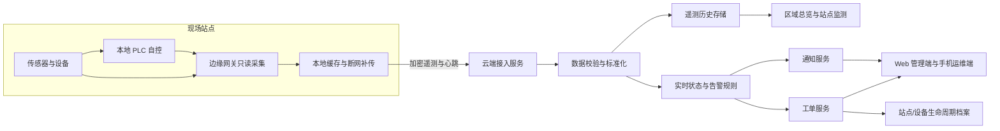

# 小禹现有平台升级改造方案

**版本：** 方案稿 1.3  
**日期：** 2026 年 11 月 13 日  
**适用范围：** 对现有村镇分散式污水处理站实施轻量数字化改造，建设远程监管、运维管理和数字档案能力

**建设原则：** 不新建污水处理站，不改变现有站点的主体处理工艺；在尽量保留现有设备和 PLC 本地控制的基础上，补充必要的采集、通信和平台能力。

## 一、方案摘要

小禹在现有平台基础上升级，面向现有农村分散污水站点逐步补齐远程监管和集中运维能力。本项目不新建污水站，也不以更换整套处理设备或重写平台为前提。实施时先盘点已投运站点和现有 PLC、仪表、网络条件，优先复用能够正常工作的设备；按需增加只读采集网关、协议转换器或少量必要传感器。现场设备继续按照各站 PLC 中已有的控制程序、联锁和保护逻辑独立运行；小禹在现有告警、工单、巡检、设备台账和权限能力上迭代，逐步实现多站数据汇总、故障通知和生命周期档案。

平台的核心边界是：**PLC 负责现场设备“干活”，小禹负责远程“看状态、报故障、统一管站点、存数据、派工单”。** 首期不承担基础工艺控制，不通过云端启停设备或修改 PLC 控制参数。现场与云端断开时，PLC 应继续按本地程序安全运行；连接恢复后，边缘网关按设计补传可补传的数据。

当前仓库已有站点切换、告警、工单、巡检、设备保养、报表和权限等业务骨架，但运行数据主要来自模拟引擎；站点数是演示配置；Node 服务以单进程和 JSON 文件作为演示存储；短信等外部通知在演示环境中并未真实发送。因而本方案把现有功能视为产品原型和可复用业务模块，不视为已完成的现场接入或生产云能力。

本次工作以现有版本为基线分批升级，不另起一套运维系统。运维端首批增量范围包括：**现有站点摸底与分批接入、多站区域总览、真实数据及质量展示、可靠告警通知、工单闭环增强、基础站点档案补齐。** 原有模拟控制、工艺参数实验、工艺流程演示、水质分析和诊断等功能，按教育用途筛选后剥离到独立教育端；建设验收资料归档和填料更换台账补入运维端。改造边界限于现有站点和现有平台，不包含新建处理站、扩建土建主体、整体替换处理系统或一次性重写全部客户端。

### 方案对应的痛点与创新点

- **痛点3：** 站点分散，缺少远程感知与集中监管手段。设备即使能够自动运行，管理人员也无法及时远程掌握运行状态和异常；老旧设备缺少统一接入渠道，现场巡检往往只能事后发现问题。
- **创新点3：** 建设智慧运维管理平台。通过存量站点数字化改造实现远程采集、在线监测、故障预警、老旧设备兼容接入、实测数据教学复用和多站生命周期管护。
- **本项目实施口径：** 不新建站点。以现有已投运站点为对象，按“先摸底、再分类、后改造”的方式实施；每站依据现有 PLC、仪表、通信和网络条件选择改造等级。
- **双端分工：** 运维端服务真实站点监管和运维；教育端服务工艺教学、模拟实验和授权实测数据教学。教育端的模拟控制只作用于虚拟设备，不得连接生产 PLC 或向生产站点下发控制命令。

## 二、建设背景与现状判断

### 2.1 现状基础

现有平台已具备或演示了以下业务能力：

- 站点切换、站点范围授权和站点关联数据。
- 实时监测、趋势、告警规则、告警处置和告警统计。
- 工单派发、接单、处理、验收、关闭以及巡检任务。
- 设备台账、运行小时、保养记录、水质化验、分析和报表。
- 用户角色、系统设置、通知通道配置、审计和备份入口。
- Web、Windows 桌面和 Android 多种客户端的原型实现。

这些能力是本次升级的现有基础。按模块复核后保留可用页面、接口和业务规则，通过向后兼容的增量改动补齐多站总览、真实设备接入、通知触达和生命周期档案；不把现有功能整体推倒重写，也不要求一次性统一所有客户端的内部实现。

### 2.2 与新定位不一致的部分

- 远程控制中心、参数下发和自动控制规则会让用户误以为云平台负责单机工艺控制。
- 工艺流程大屏、单站诊断和现场触摸屏占据较多产品注意力，而新定位首先需要区域多站监管。
- 当前数据主要由模拟引擎生成，不能作为现场实际运行数据。
- 当前“通知通道”配置与真实短信、企业微信等外部触达能力不是一回事。
- 站点列表和切换不等于完整的多站云管：仍需建设真实的跨站汇总、站点组织、统一数据服务和可扩展的站点接入流程。
- 设备保养记录尚不能覆盖建设验收、站点运维历史及填料更换等全生命周期档案。
- 多端分别维护业务逻辑和数据存储会增加同步、权限和维护成本。

## 三、产品定位、目标与边界

### 3.1 产品定位

小禹是建立在站点本地自控基础上的多站远程监管和运维平台，适用于站点分散、现场值守力量有限、设备型号和建设年代不一的运维场景。

### 3.2 产品目标

1. 监管人员能够在区域视角判断哪些站点正常、异常、离线或数据缺失，并快速定位问题站点。
2. 运维人员能够及时收到重要故障通知，将告警转成工单，跟踪责任人和处理结果。
3. 站点、设备、建设、检修和填料更换信息能够集中查询并持续留档。
4. 对现有站点按设备和通信条件分类，尽可能通过标准化配置、只读网关或必要的少量仪表改造接入。
5. 经授权的现场工况数据能够支持专业教学实践，并保留数据来源和质量说明。

### 3.3 产品边界

| 领域 | 小禹负责 | 现场 PLC / 现场人员负责 |
|---|---|---|
| 设备运行 | 读取状态、遥测、运行事件和可获得的故障信息 | 执行设备启停、工艺时序、联锁、保护和本地自动运行 |
| 异常管理 | 判断监测数据是否触发平台告警，通知和派发工单 | 现场判断、排查、维修和确认设备实际状态 |
| 工艺参数 | 展示经确认的运行数据及变更记录 | 首期由现场按既有流程设置 PLC 参数；云端不下发基础控制参数 |
| 通讯 | 监测网关和点位数据是否正常上报，展示数据新鲜度 | 网关与 PLC 间协议和采集配置按现场实施方案完成 |
| 运维 | 组织巡检、维修、验收和档案更新 | 现场执行工作并提交结果、照片或检测记录 |

平台的云端数据接口原则上采用只读遥测和状态上报。改造不得破坏现有 PLC 控制逻辑、设备联锁和安全保护，也不得因云平台不可用而阻止 PLC 本地运行。现场勘察发现原有设备或控制系统存在安全隐患时，应记录并由业主另行决策处理，不将其隐含纳入本平台改造。若未来需要远程设定或控制，应另行论证其安全边界、身份认证、现场联锁、人工授权、网络失联处理和审计要求，并作为独立项目决策，不纳入本方案。

## 四、用户角色与权限

| 角色 | 主要职责 | 典型权限 |
|---|---|---|
| 平台管理员 | 配置组织、用户、站点和接入设备 | 全平台配置、账号管理、审计查询 |
| 区域监管人员 | 监督辖区内站点运行与运维情况 | 查看授权区域、告警与报表；按职责发起督办 |
| 运维负责人 | 组织值班、告警处置和工单分派 | 查看负责站点、分派工单、复核关闭、维护运维规则 |
| 现场运维人员 | 巡检、维修、记录现场情况 | 查看本人负责工单和授权站点，提交处理结果与附件 |
| 专业人员 / 教师 | 复核水质、分析工况或组织教学 | 访问经授权的数据与分析模块，按权限导出 |
| 只读访客 | 监督或临时查看 | 只读访问指定站点和报表 |

权限同时按功能和站点范围控制。服务端必须校验每次请求的站点访问范围，界面隐藏按钮不能替代服务端鉴权。高风险配置、用户授权、恢复备份和档案删除应记录审计信息；数据更正采用留痕方式，不覆盖关键历史记录。

## 五、目标信息架构与页面方案

### 5.1 主导航

1. **区域总览**：全部授权站点的运行概况、地图或列表、告警、离线和待办。
2. **站点监测**：单站关键点位、状态、趋势、工艺单元摘要和数据质量。
3. **告警中心**：跨站告警、确认、升级、恢复、关闭及告警分析。
4. **运维工单**：派单、接单、现场处理、复核、关闭和超时督办。
5. **巡检管理**：巡检计划、路线/项目、任务执行、异常记录和转工单。
6. **站点与设备档案**：站点资料、设备、建设验收、检修、填料更换及附件。
7. **运行报表**：运行、告警、工单、设备可用性和数据完整性报表。
8. **系统管理**：组织、用户、角色、网关、点位模板、通知策略、审计和备份。

专业水质分析、化验复核、工艺诊断和教学数据从运维端主流程中分离，评估后纳入教育端。现有设备控制中心、工艺参数下发和模拟自动控制属于模拟业务，应从运维端正式产品中剥离；如对教学有价值，可迁入教育端并限定为虚拟设备。可删除重复或无使用价值的旧页面、接口和业务代码，不要求为保持兼容而永久保留不再使用的功能。

### 5.2 区域总览

区域总览要直接回答四个问题：有多少站、哪些站点需关注、为什么需关注、当前由谁处理。

建议呈现：

- 已纳入改造范围的现有站点总数及正常、告警、离线、数据异常的分布。
- 站点地图/列表切换，并支持区域、工艺、状态和运维单位筛选。
- 每站的关键状态、最后上报时间、未关闭告警、待处理工单和数据完整性。
- 按严重程度排序的跨站告警及工单待办。
- 最近一段时间的站点在线趋势、告警趋势和工单处理情况。
- 点击站点进入站点详情；点击告警进入告警处置上下文。

“在线”定义应基于站点网关最后心跳和数据超时规则；“运行设备数”与“通讯正常设备数”必须分开统计。缺少仪表的指标显示“未配置/未接入”，不得生成估算实时值冒充测量值。

### 5.3 站点详情

站点详情包含：站点概况、实时状态、点位趋势、告警、工单、设备清单、巡检、运行档案、建设资料和接入健康。优先展示关键运行指标与数据新鲜度；详细工艺图和专业诊断由用户主动进入，不作为跨站总览的替代。

## 六、核心业务需求

### 6.1 多站及组织管理

- 支持区域、乡镇、运维单位、站点等组织关系；账号可授权一个或多个站点。
- 站点具备唯一编码、名称、行政区划、位置、处理规模、工艺类型、建设与投运状态、责任单位和联系人。
- 支持将现有站点登记入平台、修改基础资料、停运、移交和归档；站点停运后历史数据和档案仍可查询。平台登记站点不代表新建实体污水站。
- 支持站点接入状态、网关状态、数据质量和版本信息的汇总。
- 可配置站点分组与标签，例如区域、工艺、承包运维单位和设备代际。

### 6.2 真实数据接入与老旧设备改造

建议采用“现有现场仪表/PLC—按需增配的边缘网关—云端接入—业务平台”的数据链路。改造优先级是先盘活现有可用数据，再补通信能力，最后才考虑增设必要测点；不默认更换整套控制系统或处理设备。

存量站点按勘察结果分级改造：

| 改造等级 | 适用条件 | 实施内容 | 约束 |
|---|---|---|---|
| 一级：配置接入 | PLC/仪表已有可用通信接口，网络条件允许 | 配置只读点位映射和安全上报，尽量不增加现场硬件 | 不改 PLC 控制程序，不影响原有控制和联锁 |
| 二级：网关改造 | 现场数据可读，但协议、接口或网络不兼容 | 增加协议转换/边缘网关，配置身份认证、缓存和补传 | 采集链路与控制链路隔离；云端不下发设备命令 |
| 三级：必要测点补充 | 关键状态确实没有可用数据，且业务上需要远程判断 | 经业主确认后增设少量必要传感器或通讯配件 | 改造前评估安装条件和维护成本，不扩大为整站重建 |

不具备安全、经济接入条件的设备可暂列“人工巡检”或“暂未接入”，纳入改造台账和后续评估。是否改造以现场勘察和业主确认结果为准，不能为了平台覆盖率强行接入或虚构数据。

- **现有站点直接接入**：若 PLC/仪表具备可用通信接口，在不影响原控制的前提下配置只读采集，交付点位清单、地址映射、单位、量程、采样周期和验收记录。
- **现有站点轻量改造**：若接口或协议不兼容，增加边缘网关或协议转换器；只有关键状态无法从现有系统获得时，才增设经过确认的必要传感器。改造范围逐站勘察，不默认更换 PLC、主体设备或处理工艺。
- **暂不具备采集条件的站点/点位**：保留为人工巡检/化验记录或“未接入”状态，说明原因和后续建议；不得将估算值冒充在线数据，也不得为了平台数据完整而进行无必要的站点重建。
- **协议接入**：网关可根据现场条件适配 Modbus RTU/TCP 等设备侧协议，并通过 MQTT over TLS 或受控的 HTTPS 通道向平台上报。具体协议与设备选型需在试点勘察后确定。
- **数据标准化**：点位统一编码、名称、单位、数据类型、量程、采样周期、所属站点/设备/工艺单元和来源标记。
- **断网处理**：网关具备本地缓存和补传能力；每个站点根据网络条件确定缓存容量与保存周期。补传数据要保留原始采集时间和补传时间。
- **数据质量**：至少标识正常、超量程、通信异常、过期、缺失、人工录入和补传；质量状态可追溯到点位与网关。
- **接入验收**：逐站验证点位映射、单位、时钟、采样周期、断网补传、告警阈值和数据来源后再转入正式运行。

平台不应把“PLC 已登记”当作已接入现场。应以现有站点现场核查、真实心跳、真实遥测和逐站接入验收记录作为接入完成依据。若某站现有设备暂不具备采集条件，应如实标记该站/点位的改造需求和未接入状态。

### 6.3 告警与通知

告警链路为：**数据接收 → 数据质量判断 → 规则判断 → 告警去重/合并 → 通知发送 → 确认/派单 → 恢复与关闭 → 统计复盘**。

- 规则支持上下限、持续时间、迟滞、静默时段、站点/设备范围和级别。
- 区分工艺异常、设备故障、网关离线、数据超时、点位质量异常和巡检发现。
- 每条告警记录原始点位值、单位、阈值、发生/恢复时间、站点、设备、通知记录及操作时间线。
- 支持站内通知和至少一种真实外部通知通道。短信、企业微信或其他通道按客户现有系统和试点条件接入，不在方案中假定某个通道已经可用。
- 通知策略按级别、时间段、站点、岗位和升级规则配置；需保存发送结果、失败原因和重试记录。
- 支持告警合并、重复抑制、确认超时升级和告警转工单；严重告警可自动创建或建议创建工单。
- 告警关闭需说明原因；恢复判定与人工关闭分开记录。

### 6.4 工单与巡检

工单状态建议为：**待分派 → 待接单 → 处理中 → 待复核 → 已关闭**，另有取消和退回路径。

工单记录站点、关联设备/告警、问题描述、优先级、责任人、时限、处理过程、备件/费用（按需要）、处理前后照片、结果和复核意见。关键状态变更写入不可随意覆盖的时间线。

巡检支持周期计划、任务分派、检查项、读数/结果、异常说明、附件和异常转工单。手机端应方便现场使用，并支持短时断网保存草稿或待提交记录；同步失败应有明确状态和重试入口。

### 6.5 站点、设备与全生命周期档案

- **既有站点建设档案**：归集现有立项/设计信息、施工单位、建设时间、竣工资料、验收结论、投运时间和历次改造记录；资料缺失时登记缺项，不补造历史记录。本项目不包含新建站点的建设施工。
- **设备档案**：设备编码、类型、品牌型号、序列号、所属站点和单元、安装/投运日期、保修信息、运行状态、维保周期和附件。
- **运维检修档案**：巡检、维修、保养、故障、备件、更换件和验收记录；与工单和设备关联。
- **填料更换档案**：填料种类、规格/批次、对应池体/单元、装填数量、装填/更换日期、供应商、原因、施工人员、前后照片和验收结果。更换记录进入对应站点和单元的时间线。
- **附件管理**：支持现场照片、检测报告和竣工资料等文件；记录上传人、时间、关联对象和访问权限。
- 对档案变更保留版本与审计；站点、设备停用时保留历史关联关系。

### 6.6 报表、分析与教学实践

运维首期报表包括站点运行概况、告警统计、工单处理、巡检完成、网关在线和数据完整性。统计数字应说明周期、来源和计算口径。

运维端保留必要的水质现场记录；去除率、能耗药耗、单元效率、工艺仿真和智能诊断的教学/实验功能优先放入教育端。用于教学的数据需要经过授权，明确数据是在线采集、人工化验还是演示数据；可提供站点类别/时间/指标筛选和脱敏导出。教学案例应关联真实运行背景、数据说明和讨论任务，不应把模拟数据标成现场实测。

## 七、现有架构上的演进建议

### 7.1 逻辑架构

### 7.2 服务分层

- **站点接入层**：面向既有 PLC 和仪表的只读网关身份、证书、协议接入、消息鉴权、心跳和接入日志。
- **数据处理层**：校验、标准化、质量标签、实时状态、告警规则和事件总线。
- **业务服务层**：组织站点、用户权限、告警、工单、巡检、设备档案、通知、报表和审计。
- **数据层**：关系型业务数据、具备时间范围查询能力的遥测存储、对象附件存储和备份。
- **应用层**：响应式 Web 管理端、手机端运维体验；首期避免让多个客户端各自实现一套完整业务规则。

### 7.3 渐进演进原则

优先沿用现有 Node 服务、API 契约、Web 页面和业务模块，先把服务部署方式从本地演示调整为受控的集中服务实例，并新增真实网关数据适配、站点汇总接口和通知连接器。模拟引擎从运维生产链路剥离，作为教育端仿真或开发测试工具；真实现场数据走新增接入链路，并通过环境与来源标识隔离。现有 JSON 存储可用于有限规模的试点验证；当并发、数据保留、备份恢复或多用户访问需求达到现有存储能力边界时，再分阶段增加数据库或遥测存储，按模块迁移并保留回退路径，不在首期整体替换后端。

Web 管理端继续作为平台管理与监管入口；现有 Android 端优先补强告警接收、工单处理、巡检和附件上传。Windows 桌面端和现场 kiosk 暂不强制下线，可继续服务已有本地使用场景，但应明确其本地数据与集中服务数据的边界，不把未实现的自动同步描述为现成功能。后续需要多端共享同一份生产数据时，以现有服务 API 为基础逐步接入，避免一次性重写客户端。

### 7.4 教育端隔离原则

- 教育端可复用筛选后的页面组件、工艺模型和教学数据结构，但使用独立入口、账号角色、环境配置和仿真数据空间。
- 教育端仿真设备不得获得生产网关凭据，不配置到生产 PLC 的网络路由，也不订阅/发布生产控制主题。
- 生产数据进入教育端须经过授权、脱敏和只读副本/导出流程；教育端不可回写告警、工单、站点档案或现场设备。
- 教育端与运维端共享代码时仍须在服务端实施环境和权限隔离，不能只依靠界面隐藏功能。
- 将现有模拟控制功能迁移前先盘点其教学价值和维护成本；无明确课程/实验用途的页面、接口和代码可直接删除。

## 八、核心数据对象与关系

| 数据对象 | 主要字段/关系 | 用途 |
|---|---|---|
| 组织与区域 | 组织编码、上级组织、区域范围 | 组织站点和用户授权范围 |
| 站点 | 编码、位置、规模、工艺、状态、责任单位 | 多站总览和站点档案 |
| 网关 | 站点、设备标识、型号、协议、证书、固件/配置版本、心跳 | 监测接入设备和通讯健康 |
| 点位模板 | 编码、名称、单位、类型、量程、采样周期、质量规则 | 标准化站点数据和批量配置 |
| 点位实例 | 站点、网关、设备、模板、现场地址、来源 | 将现场地址映射为平台标准点位 |
| 遥测记录 | 点位、采集时间、入库时间、值、单位、质量、来源 | 趋势、统计、告警和教学数据 |
| 设备 | 站点、单元、编码、型号、安装/投运、状态 | 设备台账及维护履历 |
| 告警规则/事件 | 规则、站点/点位、阈值、等级、状态、时间线 | 异常判断与告警闭环 |
| 通知记录 | 接收人、通道、尝试时间、结果、重试次数 | 证明通知是否实际送达或失败 |
| 工单/巡检 | 站点、设备、告警、人员、状态、时间线、附件 | 运维任务闭环 |
| 生命周期记录 | 站点/设备/单元、记录类型、时间、内容、附件 | 建设、验收、检修、填料更换和变更历史 |
| 用户与权限 | 组织、角色、功能权限、站点范围、有效状态 | 保障多租户/多区域数据隔离 |
| 审计事件 | 操作者、时间、对象、动作、前后值、来源 | 追溯管理和运维操作 |

遥测记录的采集时间与服务器接收时间必须分别保存，便于识别网络延迟和补传数据。所有指标应显示单位和来源；人工录入不能与在线仪表值混为一谈。

## 九、非功能、安全与运行要求

### 9.1 安全

- 站点网关使用独立身份，采用加密传输和可撤销凭据；不得共用一个长期不变的公开口令。
- 服务端对用户、站点和功能进行逐请求鉴权；高权限账号启用更强认证措施。
- Web、API、数据库和附件访问按最小权限配置；敏感配置加密保存并限制查看。
- 生产、测试和演示环境分离；演示账号和模拟数据不能接入生产站点。
- 定义数据保留、备份、恢复、导出和删除策略；关键档案和审计日志有备份和恢复演练。
- 网关只开放所需出站连接；现场网络改造需由实施方按站点网络条件评估并留存记录。

### 9.2 稳定性与可观测性

- 监测云端接入服务、消息积压、告警处理、通知失败、数据库容量和备份状态。
- 站点数据状态可区分在线、迟到、过期、断联和质量异常。
- 网关补传需具备幂等处理，避免同一批数据重复产生告警或统计。
- 发布和配置变更有版本、审批或复核机制，能追溯变更影响的站点。
- 服务故障恢复后，告警、工单、档案和审计数据不得因进程重启丢失。

### 9.3 建议的首期目标指标

下表为试点验收建议值，最终目标应在确定采样频率、网络条件、云部署和通知服务后签署，不应直接当作当前平台能力声明。

| 指标 | 建议的首期目标 |
|---|---|
| 站点接入可追溯率 | 100% 的试点站点有网关、点位映射和接入验收记录 |
| 关键点位来源标识 | 100% 显示在线、人工、缺测或演示来源 |
| 站点状态更新时间 | 总览能显示最后心跳/数据时间，并按配置识别过期 |
| 告警闭环记录 | 100% 的试点告警有规则依据、状态时间线和处理结果 |
| 通知审计 | 每次通知记录通道、目标、发送结果和失败原因 |
| 工单追溯 | 100% 已关闭工单记录处理人、结果和关闭时间 |
| 档案完整度 | 试点站点完成基本信息、设备清单和已有建设/检修资料导入 |
| 本地自治验证 | 通过断开云连接的现场验证，证明 PLC 本地控制仍独立运行 |

## 十、现有功能保留与增量调整

| 现有模块/能力 | 处置建议 | 说明 |
|---|---|---|
| 站点列表与站点切换 | 保留并增量增强 | 增加跨站汇总、区域筛选、现有站点登记/停运和接入状态 |
| 实时监测和趋势 | 保留并扩展数据源 | 保留现有演示数据路径，新增真实网关接入；完善质量、过期、来源和补传标记 |
| 告警中心 | 保留并增强 | 补齐真实通知送达、失败重试、去重和跨站排序 |
| 工单和巡检 | 保留 | 收敛状态模型，关联站点、设备、告警、人员和档案 |
| 设备保养 | 保留并扩展 | 在现有设备与保养记录上加入安装、保修、检修和备件历史 |
| 站点建设与填料更换 | 新增 | 建立结构化档案、附件和时间线 |
| 设备控制中心 | 从运维端剥离 | 若模拟控制适合教学，迁入教育端并只操作虚拟设备；否则删除 |
| 工艺参数云端下发 | 从运维端剥离 | 现场 PLC 参数由既有现场流程管理；教育端可保留虚拟参数实验 |
| 云端自动控制规则 | 从运维端移除控制动作 | 运维端规则只产生告警、通知或工单；教育端的自动控制仅运行于仿真环境 |
| 工艺流程图与现场 kiosk | 按使用场景拆分 | 教学流程演示进入教育端；仍有现场值守需求的 kiosk 单独评估是否保留 |
| 化验、水质分析、深度诊断 | 按用户和数据边界拆分 | 运维端保留必要的现场记录；教学分析、仿真诊断和实验功能进入教育端 |
| 模拟网关与模拟引擎 | 从运维生产链路隔离 | 可作为教育端仿真核心或开发工具；不得向生产站点提供伪造遥测 |
| 多端独立本地引擎 | 盘点后收敛 | 保留确有离线/教学价值的实现；生产多站共享逐步转向现有服务 API，淘汰重复且无使用价值的实现 |

### 10.1 数据保护与渐进接入

1. 先盘点现有页面、API、模拟引擎、用户、站点、设备、点位、告警、工单和档案，标明运维端保留、教育端迁入、删除三类处置结果。
2. 将模拟环境和数据归入教育/开发用途并标记来源；不把演示数据改写成现场实测数据。
3. 现有站点和用户数据优先通过增量字段/配置扩展，不做全量重建；新增字段设置兼容默认值。
4. 导入真实档案前由业务人员核对站点、设备编码和资料来源；缺失历史信息登记为缺项。
5. 选择试点站并行核对现场 PLC/仪表、网关和平台点位值、单位、质量及时间戳。
6. 以功能开关或站点配置逐站启用真实接入；教育端与运维端使用独立环境、账号权限和数据写入边界。出现问题时可退回原有服务版本，不丢失原数据。

## 十一、实施阶段与交付物

### 阶段 0：现状盘点与增量需求确认

**工作内容：** 盘点现有已投运试点站点、PLC 品牌/型号、可读协议、网络、电源、现有仪表、数据项、运维人员和通知渠道；按接入条件划分改造等级，明确哪些数据在线、哪些需人工录入、哪些设备暂不改造。

**交付物：** 站点清单、设备和点位清单、控制边界说明、数据字典、试点接入设计、业务流程和确认后的首期范围。

**退出条件：** 每个试点站有可执行的存量改造方案，清楚标明拟复用设备、增配设备、暂不接入项、现场施工范围、责任方、数据来源和风险；方案确认不包含新建站点或整体替换处理系统。

### 阶段 1：在现有平台上补齐多站监管

**工作内容：** 复用现有站点、用户、权限、告警、工单、巡检和报表模块，在现有 Web 导航与 API 中增量增加区域总览、跨站告警筛选、接入状态和数据质量展示。将现有服务部署到授权的集中运行环境并做必要的安全加固；不另建一套平台，也不要求首期更换业务框架或数据库。

**交付物：** 现有平台的增量版本、跨站汇总接口与页面、集中部署和访问配置、数据备份方案、演示/试点环境隔离说明。

**退出条件：** 使用受控试点数据完成“站点数据到区域总览、告警到工单再到关闭”的完整流程。

### 阶段 2：边缘网关与现场数据接入

**工作内容：** 在现有模拟数据链路之外增加真实网关数据适配，完成点位映射、加密上报、心跳、缓存、补传、质量标记和逐站接入验收；按各站改造等级实施，不要求所有站点采用相同硬件改造。原模拟链路继续服务演示，不覆盖真实站点数据。

**交付物：** 只读 HTTP 接入契约、网关配置模板、点位模板、安装/验收手册、现场接入日志和逐点比对记录。

**退出条件：** 试点站经现场验证可连续上报，断网后 PLC 仍正常独立运行，恢复后补传行为符合设计。

### 阶段 3：通知、运维、生命周期与教育端拆分

**工作内容：** 在现有通知、巡检、移动端和设备保养模块上增量完善通知升级和现场提交流程；增加建设验收资料与填料更换记录；导入经核对的现有站点历史资料。同时将模拟控制、仿真工艺流程、参数实验及适合教学的分析功能拆分为教育端，清理运维端不再需要的入口和代码。

**交付物：** 通知报告、运维流程手册、档案导入结果、现场人员培训材料、教育端功能清单及数据隔离方案。

**退出条件：** 真实告警能够触达责任人，工单和检修记录可追溯到设备与站点。

### 阶段 4：扩大现有站点纳管范围、分析与教学应用

**工作内容：** 按接入模板将更多现有站点纳入运维端；完善教育端教学实验和案例。经授权后，将生产实测数据通过只读、脱敏的副本提供给教育端，不允许教育端修改运维档案或回写现场设备。

**交付物：** 既有站点纳管扩围评估、运营指标报告、教学数据规范和案例资料。

**退出条件：** 每批新增纳管的既有站点都有明确接入验收与运维责任人，数据质量和档案完整度达到约定目标。此处“扩站”仅指扩大平台纳管的现有站点范围，不指新建污水站。

## 十二、试点方案与验收方法

建议先选择 **2 至 3 个已投运的现有站点**开展试点：至少包含一个接入条件较好的站点，以及一个存在老旧设备或通信限制、需要网关适配的站点。试点应能代表后续现有站点的主要接入类型；实际数量根据项目资源和现场条件确定。

每站试点依次完成：

1. 现场勘察和点位确认。
2. 网关安装与网络/安全配置。
3. 点位映射和现场值比对。
4. 数据超时、设备状态异常等告警验证。
5. 通知送达、失败重试和责任人升级验证。
6. 告警转工单、手机处理、复核关闭验证。
7. 断网测试，确认 PLC 不依赖平台运行，并检查网关缓存/补传。
8. 站点、设备、检修和填料档案抽查。
9. 试点运行复盘，确定问题、单站改造成本、可复用配置和后续现有站点纳管标准。

验收记录应包含测试条件、实际结果、未通过项、责任人和复验结果。运行时长、采集成功率等量化门槛应结合网络情况和现场协议在试点合同或实施计划中确定；未验证前不得宣称已达到目标。

## 十三、风险与应对

| 风险 | 影响 | 应对办法 |
|---|---|---|
| PLC 型号和通信协议差异大 | 接入工作量和现场成本不确定 | 先做站点勘察和样机联调；优先标准只读接入；形成分类型网关模板 |
| 老旧点位没有传感器或精度不足 | 关键状态无法可靠判断 | 把“未布点/人工巡检”明确展示；按风险与预算增配必要传感器 |
| 网络不稳定 | 数据延迟、告警不及时 | 网关缓存补传、心跳超时告警；明确云告警不能代替 PLC 本地保护 |
| 告警规则不适配实际工况 | 误报、漏报、人员疲劳 | 先影子运行规则，跟现场人员校准阈值、持续时长和升级规则 |
| 外部通知平台不可用 | 故障信息无法触达 | 记录发送结果和重试；设置备用联系人/通道和站内待办 |
| 多端数据不一致 | 运维记录割裂 | 统一云端业务数据源；明确移动端离线数据的提交和冲突处理 |
| 演示数据混入生产 | 监管和教学误判 | 环境隔离、数据源标识、生产账号和网关白名单 |
| 档案资料缺失 | 生命周期台账不完整 | 分站点分阶段补录，记录缺失项和资料来源，不伪造历史记录 |
| 云端或网关被未授权访问 | 数据泄露或系统被滥用 | 独立身份、加密通信、最小权限、凭据轮换、审计和安全更新 |
| 教育端越权访问运维数据或现场设备 | 教学环境影响生产或暴露敏感信息 | 独立凭据和数据空间、只读脱敏副本、无生产网络路由、禁止控制接口和回写权限 |

## 十四、项目组织与责任建议

| 角色/团队 | 主要责任 |
|---|---|
| 业务负责人 | 确认产品范围、运维流程、告警级别和验收口径 |
| 平台研发团队 | 云端架构、数据模型、权限、告警工单、应用和运维监控 |
| 自动化/网关团队 | PLC/仪表调研、协议适配、网关配置、缓存补传和现场调试 |
| 现场运维单位 | 提供站点资料、确认工况和告警规则、执行工单并复核结果 |
| 网络/安全负责人 | 网络接入、账号证书、云部署、安全审查和备份恢复 |
| 教学负责人 | 明确数据授权、脱敏要求、课程场景和实践案例，不影响运维数据准确性 |

每个试点站应指定站点负责人、平台联系人和现场联调联系人。告警责任人、通知时限和工单验收人应在上线前确认。

## 十五、本期增量范围清单

### 在现有平台上新增或补齐

- 区域总览和跨站告警/工单汇总，复用现有站点、账号和授权模型。
- 现有站点接入状态、数据来源、质量和最后更新时间展示。
- 至少一条真实网关接入链路及逐点验收。
- 告警规则、跨站告警列表、告警时间线。
- 站内通知和一种真实外部通知通道的送达验证。
- 在现有工单流转和审计基础上，补充告警关联、现场附件与检修记录关联。
- 现有站点、设备和保养档案的增量字段与填料更换记录。
- 演示/试点数据来源隔离、现有服务备份与恢复方案。
- PLC 本地独立运行与云断连测试。

### 教育端建设范围

- 虚拟站点、模拟遥测和工艺流程教学演示。
- 与真实站点完全隔离的设备控制/参数实验沙箱；操作不连接 PLC、不触发现场命令。
- 水质化验、去除率、能耗分析、诊断案例和实践课程任务。
- 经授权、脱敏、只读的现场工况数据集，保留站点类别、时间范围、采集来源和质量说明。
- 教师、学生和运维人员分角色授权；教学账号默认不能访问个人信息、运维敏感信息或可识别具体站点的数据。

### 后续迭代

- 站点建设验收资料结构化和附件管理。
- 填料更换计划、提醒、记录和验收。
- 高级巡检路线、备件与成本管理。
- 专业工艺诊断、水质分析和能耗药耗分析。
- 教学数据集、案例和受控导出。
- 更丰富的网关协议模板、批量部署和远程配置管理（仅限网关接入配置，不涉及 PLC 工艺控制）。

### 本期不做

- 云平台直接启停泵、风机或执行反冲洗。
- 通过云端修改 PLC 基础工艺参数或控制程序。
- 用模拟数据替代现场实测数据。
- 在真实试点验收前承诺采集成功率、连续运行天数或节能效果。
- 推倒现有平台另建一套系统，或一次性重写所有客户端、业务模块和数据存储。
- 将教育端仿真操作连接到真实 PLC，或允许教学环境回写生产站点和运维档案。

## 十六、决策事项

进入实施前需要项目方确认以下事项：

1. 首批试点站点及每站联系人、运维责任单位。
2. 允许采集的数据点位、现有 PLC/仪表信息和现场网络条件。
3. 云平台部署位置、数据存储周期、备份地点和访问边界。
4. 告警级别、通知对象、升级时限和可用的外部通知通道。
5. 站点建设资料、检修记录和填料更换资料的现状及补录责任人。
6. 水质化验、教学数据使用的授权、脱敏和导出边界。
7. 试点验收周期与定量指标，尤其是在线率、补传、通知送达和工单时限的计算口径。

## 十七、结论

小禹本次以现有平台为底座渐进升级：运维端保留并增强告警、工单、巡检、设备台账和权限，补齐真实现场接入、跨站总览、可靠通知和生命周期档案；将模拟控制、仿真流程、水质分析和适合教学的诊断能力筛选后独立到教育端，删除不再需要的重复功能。教育端可使用隔离仿真和授权的只读实测数据，但不能连接 PLC 或回写生产数据。不新建污水站、不整体替换现有处理设备，也不推倒平台重写。先在少量现有站点验证接入和运维闭环，再按站点条件复制推广；全程保持 PLC 本地自治，云平台不可用不应影响站点基础处理流程。
